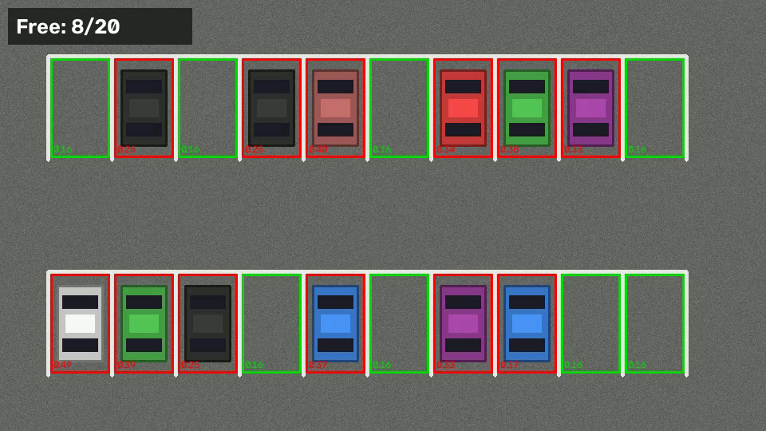

# Parking Space Detection

Detects free vs. occupied parking spots in video using classical computer
vision (OpenCV) — no trained model needed.

**How it works:** each frame is converted to grayscale, blurred, and adaptively
thresholded so texture (cars) becomes white pixels. For every marked spot the
white-pixel fill ratio is computed; a ratio above the threshold means the spot
is occupied. Free spots are drawn green, occupied ones red, with a live
`Free: N/M` counter.



## Setup

```
pip install -r requirements.txt
```

## Quick start (synthetic demo)

```
python generate_demo.py                 # creates data/parking.mp4 + data/spots.json
python main.py --video data/parking.mp4
```

## Using your own footage

1. Record or download a fixed-camera video of a parking lot
   (e.g. the classic `carPark.mp4` used in many tutorials).
2. Mark the spots once:
   ```
   python select_spots.py --video data/myvideo.mp4 --spots data/spots.json
   ```
   Drag with the left mouse button to add a spot, right-click a spot to
   delete it, `u` to undo, `s` to save.
3. Run detection:
   ```
   python main.py --video data/myvideo.mp4 --spots data/spots.json
   ```
   Use `--threshold` (default `0.22`) to tune sensitivity — raise it if empty
   spots are flagged occupied, lower it if cars are missed. The small number
   drawn in each spot is its current fill ratio, which makes tuning easy.

Webcam: pass a camera index, e.g. `python main.py --video 0`.
Save annotated output: add `--save out.mp4` (and `--headless` to skip the window).

## Evaluation on real data (CNRPark)

Evaluated on the [CNRPark dataset](http://cnrpark.it) (Amato et al.) —
12,584 real camera patches of individual parking spots from two viewpoints
(camera A and B), each labeled free/busy.

```
python eval_cnrpark.py          # baseline: fill-ratio threshold
python train_classifier.py     # 15 texture features + logistic regression
```

| Method | Protocol | Accuracy | F1 |
|---|---|---|---|
| Fill-ratio threshold (baseline) | tune on A, test on B | 73.7% | 0.80 |
| Texture features + logistic regression | train on A, test on B (cross-camera) | 83.2% | 0.89 |
| Texture features + logistic regression | 80/20 split, both cameras (within-camera) | 92.0% | 0.94 |

The 15 features per patch: adaptive-threshold fill ratio, Canny edge
density, Laplacian variance, gray mean/std, mean saturation, and Sobel
gradient energy over a 3×3 grid. Cross-camera is the harder protocol
(unseen viewpoint); within-camera matches real deployment, where the
system is calibrated on its own fixed camera.

## Files

| File | Purpose |
|---|---|
| `detector.py` | Core logic: preprocessing, per-spot classification, overlay drawing |
| `select_spots.py` | Interactive mouse tool to mark spot rectangles → `spots.json` |
| `main.py` | Run detection on a video/webcam/image |
| `generate_demo.py` | Build a synthetic parking-lot video for testing |
| `eval_cnrpark.py` | Baseline fill-ratio evaluation on the CNRPark dataset |
| `train_classifier.py` | Texture-feature + logistic-regression classifier, cross-camera eval |

## Limitations / next steps

- The camera must be fixed; if it moves, re-mark the spots.
- Strong shadows or rain can shift fill ratios — tune `--threshold`, or
  compute a per-spot baseline from an empty-lot frame.
- For a learned approach, swap `update_spots` for a YOLO model
  (e.g. `ultralytics`) and match detected car boxes to spots by IoU.
